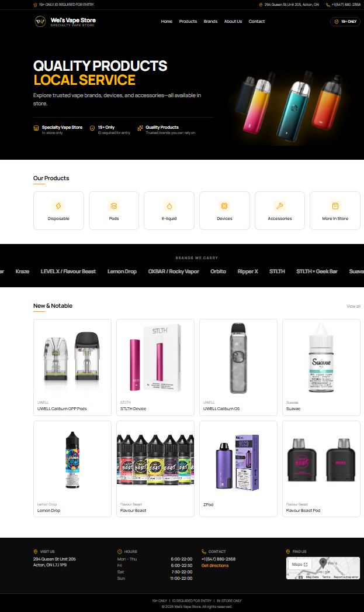
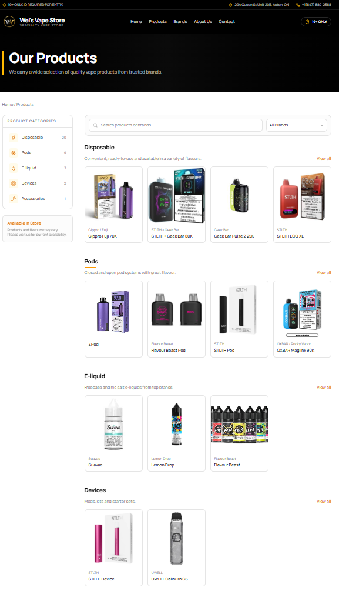
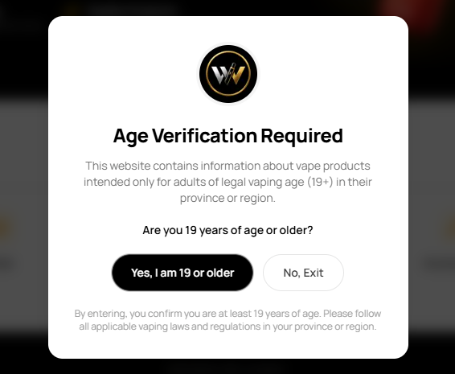
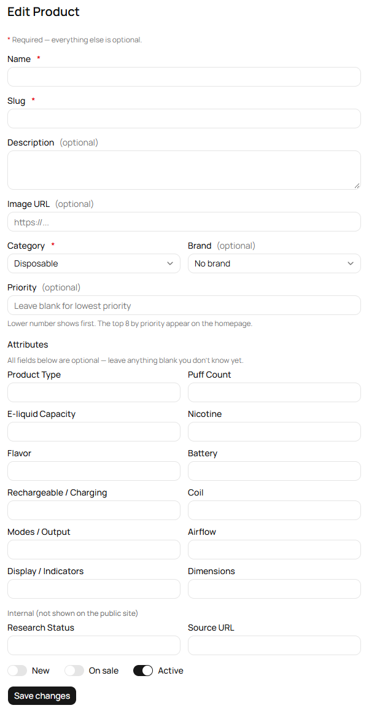
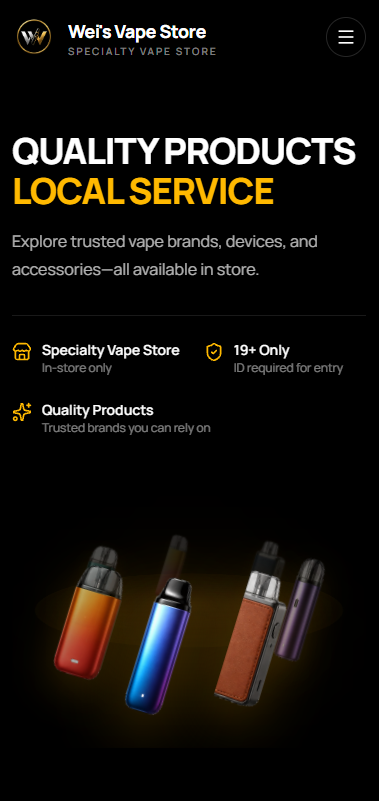
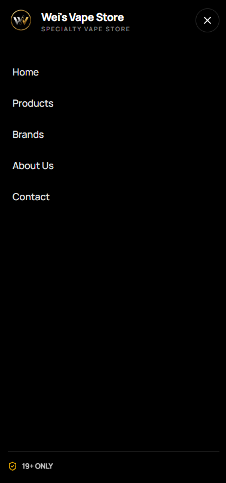

# Vape Store — Catalog Website & Admin CMS

A full-stack website for a local, brick-and-mortar specialty vape shop: a public product catalog plus a private admin CMS for the shop owner to manage it. It is **catalog-only by design** — no cart, no checkout, no live inventory. Every product page says "Available in store — contact us for current availability", and prices are intentionally never shown publicly.

**Live demo:** <https://wei-vape-store.vercel.app/>

## Screenshots

| Home | Products (filter, search, brand) |
|---|---|
|  |  |

| Age verification | Admin: product form |
|---|---|
|  |  |

| Mobile home | Mobile menu |
|---|---|
|  |  |

## Highlights

- **Instant product browsing** — the `/products` page fetches the whole catalog once on the server (SSR, so the first paint is fast and crawlable), then filters by category, brand and free-text search entirely in the browser. No request per filter change, and the URL (`?category=pods&brand=stlth`) stays shareable and deep-linkable.
- **Flexible per-category product attributes** — a disposable has puff count and nicotine strength, an e-liquid has VG/PG ratio, a device has battery and output modes. Instead of one rigid schema, attributes live in a Postgres `jsonb` column and are validated per category with Zod; the admin form renders different fields depending on the selected category.
- **Admin CMS gated by Google sign-in** — Auth.js v5 with an email allowlist (`ALLOWED_ADMIN_EMAILS`). Anyone else who signs in with Google is rejected.
- **Manual ordering with `priority`** — an optional integer per product (lower = first, blank = last). The homepage shows the top 8 by priority, and every product listing uses the same ordering.
- **Age verification gate** — a non-dismissable 19+ modal shown once per browser session on the public site.
- **Responsive storefront** — fixed mobile header with hamburger menu, infinite brand marquee (pure CSS, pauses on hover, respects `prefers-reduced-motion`), and a placeholder image for products without photos.
- **Spreadsheet import** — a script that loads real product research data from an Excel file into the database.
- **Deploy anywhere** — multi-stage Docker image (Next.js `standalone` output) for self-hosting, or Vercel + Neon with migrations applied automatically on build.

## Tech Stack

| Area | Choice |
|---|---|
| Framework | Next.js 16 (App Router, Turbopack), React 19, TypeScript (strict) |
| Styling / UI | Tailwind CSS v4, shadcn/ui (Base UI primitives), Manrope font |
| Database | PostgreSQL 16, Prisma 7 (`prisma-client` generator + `@prisma/adapter-pg`) |
| Auth | Auth.js v5 (Google OAuth, JWT sessions, no database adapter) |
| Validation | Zod 4, `@t3-oss/env-nextjs` for typed environment variables |
| Tooling | pnpm, ESLint, Docker / Docker Compose |
| Hosting | Vercel + Neon (production), Docker Compose Postgres (local) |

## Architecture

```
app/**  (pages, Server Components)
   │
   ▼
server/actions/*    auth check → Zod validation → call service → revalidatePath
   │
   ▼
server/services/*   business rules (slug handling, singleton upsert, ordering)
   │
   ▼
lib/prisma.ts       Prisma client (Postgres via driver adapter)
```

Components never import Prisma directly. Server Components fetch through services and pass plain, serializable data (`lib/serialize-product.ts`) to Client Components.

### Data model

`Category`, `Brand`, `Product`, `Banner`, and a singleton `StoreInfo` row (address, hours, phone, map embed).

`Product` holds the common fields (name, slug, category, brand, `isNew`, `isOnSale`, `isActive`, `priority`, `imageUrl`) plus `attributes jsonb` for the category-specific specs. Categories are admin-editable rows rather than a hard-coded enum; a category without a dedicated schema falls back to a generic key/value shape.

## Design Decisions

**`jsonb` attributes instead of EAV.** One admin, a small catalog, and no requirement to filter or sort by spec values — so entity-attribute-value tables would only add joins and extra CRUD for attribute definitions. Type safety is recovered in the app layer with per-category Zod schemas; a GIN index on the column is the escape hatch if faceted filtering is ever needed.

**Client-side filtering over per-filter queries.** The whole catalog is a few dozen rows, so one query plus `useMemo` filtering beats a database round trip per click. The URL is kept in sync with the raw History API (`replaceState`) rather than Next's router, specifically so filtering never triggers a server refetch.

**No upload infrastructure.** Product and banner images are plain URLs entered in the admin. That removed an object-storage dependency entirely; the trade-off is a less friendly editing flow for non-technical users.

**`priority` sorts nulls last.** Prisma `orderBy: [{ priority: { sort: "asc", nulls: "last" } }, { createdAt: "desc" }]`, so unprioritised products simply follow the prioritised ones, newest first. Clearing the field in the admin writes an explicit `null` so a stale value can't linger.

**Age gate with `useSyncExternalStore`.** The gate reads `sessionStorage`, which doesn't exist during SSR. Subscribing through `useSyncExternalStore` (with a server snapshot) avoids both hydration mismatches and calling `setState` inside an effect.

**Admin auth without a user table.** Sessions are JWT-only; "is this person an admin?" is just an allowlist check on the Google email. There's nothing to migrate and no user records to manage.

## Getting Started

**Prerequisites:** Node 24, pnpm, Docker.

```bash
# 1. Install dependencies
pnpm install

# 2. Configure environment
cp .env.example .env
#    then fill in AUTH_SECRET (e.g. `openssl rand -base64 32`),
#    AUTH_GOOGLE_ID / AUTH_GOOGLE_SECRET and ALLOWED_ADMIN_EMAILS

# 3. Start Postgres
docker compose up -d postgres

# 4. Apply migrations, generate the client, seed categories + store info
pnpm db:migrate
pnpm db:seed

# 5. Run the app
pnpm dev
```

Open <http://localhost:3000>. The admin lives at `/admin`.

> **Local admin access:** in `next dev` the admin auth gate is bypassed (`src/lib/dev-auth-bypass.ts`) so pages can be exercised without a Google round trip. This keys off `NODE_ENV`, which Next.js forces to `production` for `next build` / `next start` and the Docker image, so it cannot be active in a deployment.

### Useful scripts

| Command | What it does |
|---|---|
| `pnpm dev` | Start the dev server |
| `pnpm build` | `prisma generate` → `prisma migrate deploy` → `next build` |
| `pnpm lint` | ESLint |
| `pnpm db:migrate` | Create/apply a migration in development |
| `pnpm db:seed` | Seed the five default categories and the `StoreInfo` singleton |
| `pnpm db:studio` | Open Prisma Studio |
| `pnpm db:import-research` | Import product data from the research spreadsheet |

## Deployment

**Vercel + Neon.** Set `DATABASE_URL`, `AUTH_SECRET`, `AUTH_GOOGLE_ID`, `AUTH_GOOGLE_SECRET` and `ALLOWED_ADMIN_EMAILS`. `AUTH_URL` is not needed — `trustHost: true` lets Auth.js derive the callback URL from the request. The build script applies pending migrations before building, so schema changes reach production on deploy. `output: "standalone"` is disabled on Vercel via the `VERCEL` env var, since it conflicts with Vercel's own packaging.

**Docker (self-hosted).**

```bash
docker build -t vape-store .
docker run --env-file .env -p 3000:3000 vape-store
```

The image uses Next.js `standalone` output, runs as a non-root user, and `docker-entrypoint.sh` runs `prisma migrate deploy` before starting the server.

## Project Structure

```
prisma/                 schema, migrations, seed
scripts/                spreadsheet import
src/
├── app/
│   ├── (public)/       home, products, product detail, brands, about, contact
│   ├── admin/          login + protected CMS (products, categories, brands, banners, store info)
│   └── api/auth/       Auth.js route handler
├── components/
│   ├── public/         header, footer, product explorer, age gate, marquee, ...
│   ├── admin/          forms, sidebar, dynamic attribute fields
│   └── ui/             shadcn/ui primitives
├── lib/                env, auth, prisma, attribute schemas, validations, serializers
├── server/
│   ├── actions/        Server Actions (auth check + validation)
│   └── services/       data-access / business logic
└── proxy.ts            protects /admin/** (Next.js 16 replacement for middleware)
```

## Notes & Lessons

- Targets bleeding-edge majors (Next 16, Prisma 7, shadcn on Base UI), where much existing documentation is out of date. Notable differences: `proxy.ts` instead of `middleware.ts`, Promise-based `params`/`searchParams`, Prisma driver adapters being mandatory, `Decimal` values not being serializable across the Server→Client boundary, and `render` props instead of `asChild`.
- The first Vercel deploys failed three separate ways — a gitignored generated Prisma client, an env var that was validated but never used, and `standalone` output clashing with Vercel's packaging. Each fix is now encoded in `package.json`, `env.ts` and `next.config.ts`.
- Banner management is implemented but currently hidden from the admin navigation; the pages and data are intact.

## License

Code released under the [MIT License](LICENSE), including the logo and favicon included in this repository.

"Wei's Vape" is the name of the local shop this site was built for and is used here for demonstration only; it is not licensed for reuse as a brand. Vape product and brand names shown in the data are the property of their respective owners.
